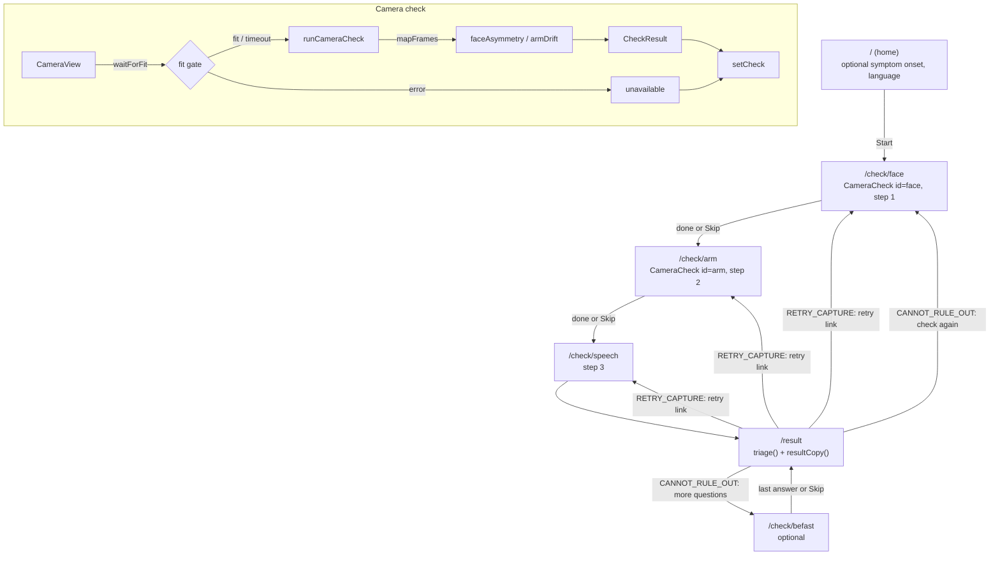

# Design: Check Flow

## Overview



The 911 button sits in the sticky header of `+layout.svelte`, above every node in this chart. Every screen writes to the session stores. Only `/result` reads them back and calls the engine.

## Components

- `CameraCheck.svelte`: one face or arm screen. Props `id`, `next`, `back`, `duration`, `step`. Phases `ready → checking → done`. Owns the headline, instructions, Start, Back and Skip, the voice prompts and the coaching line. In dev it logs the measured `CheckResult` to the console.
- `CameraView.svelte`: the camera shell. Status `idle → starting → fitting → running → done`, or `denied` / `unsupported`. Starts the camera when `active` becomes true, runs the gate and the capture, draws the canvas guide, shows the progress bar, and calls `onfit` and `oncomplete`.
- `FaceGuide.svelte`: a static SVG face outline. Used on home and as the face placeholder before the video is live.
- `FlowProgress.svelte`: "step n of total" with accent bars. Informational only.

Capture lengths are set in the routes: face uses the `CameraCheck` default of 5000 ms, arm passes `duration={10000}`.

## Data contracts

From the vision layer to the metrics (`mapFrames.ts`):

```ts
interface NormLandmark { x: number; y: number; visibility?: number }
interface FaceResultLike {
  faceLandmarks: NormLandmark[][];
  faceBlendshapes: { categories: { categoryName: string; score: number }[] }[];
}
interface PoseResultLike { landmarks: NormLandmark[][] }

faceFrameFromResult(res: FaceResultLike, w, h): FaceFrameInput | null
armFrameFromResult(res: PoseResultLike, w, h): ArmFrameInput | null
```

`FaceFrameInput` and `ArmFrameInput` are defined in `.kiro/specs/metrics/design.md`. Structural types keep `mapFrames.ts` free of MediaPipe imports, so it runs in the node test env.

Vision entry points (`index.ts`):

```ts
type FitHint = Exclude<ArmFit, 'ok'> | Exclude<FaceFit, 'ok'>;   // 'shoulders' | 'wrists' | 'face' | 'smile'

waitForFit(kind: 'face' | 'arm', video, signal, onHint: (h: FitHint) => void)
  : Promise<'fit' | 'timeout' | 'aborted' | 'error'>

runCameraCheck(kind: 'face' | 'arm', video, signal, onUnavailable: () => CheckResult)
  : Promise<CheckResult>
```

Session (`session.ts`):

```ts
locale: Writable<Locale>
symptomOnset: Writable<SymptomOnsetRecord | null>   // { choice: SymptomOnset; recordedAt: number }
checks: Writable<Record<CheckId, CheckResult>>      // all start as unavailableCheck(id)
beFast: Writable<Partial<Record<BeFastQuestion, Answer>>>
caregiverReports: Writable<CaregiverReport[]>
setCheck(result: CheckResult), setBeFastAnswer(q, a), setCaregiverReport(r, observed)
```

`/result` builds `TriageInput = { checks, beFast, caregiverReports, baseline: null }`. `CheckResult`, `TriageInput` and `TriageResult` are defined in `.kiro/specs/triage-engine/design.md`.

Dev harness (`testHarness.ts`): `FaceFirstDevApi` with chainable `face`, `arm`, `speech`, `faceClip`, `armClip`, `befast`, `caregiver`, `lang`, `reset`, plus `evaluate(): TriageResult` and `show()`.

## Vision pipeline

Both landmarkers are created lazily behind a cached promise, so the WASM and models load on the first gate of the first check, not on the home screen. The default MediaPipe delegate is used. Face blendshapes are on. Facial transformation matrices are not requested, because no metric uses them.

`collect()` drives detection with `requestAnimationFrame`. It skips a tick when `video.currentTime` has not moved and passes `performance.now()` as the timestamp, which is strictly increasing. A per-frame exception is swallowed. The loop ends when the `AbortSignal` fires.

Mirroring is CSS only (`transform: scaleX(-1)` on the `<video>`). The pixels sent to MediaPipe are not flipped, so both metrics get `{ mirrored: false }` and return anatomical sides. The side mapping itself lives in `lib/metrics/geometry.ts`.

## Capture-quality gates

`waitForFit` runs the same detection loop and asks the metric's own per-frame test:

| Check | Per-frame test | Needed | Time limit | Hints |
|---|---|---|---|---|
| Arm | `armFit`: both shoulders and both wrists usable | `QUALITY.ARM_FIT_FRAMES` in a row | none | `shoulders`, then `wrists` |
| Face | `faceFit`: usable face, `max(mouthSmileLeft, mouthSmileRight) ≥ QUALITY.FACE_SMILE_START` | `QUALITY.FACE_SMILE_FRAMES` in a row | `QUALITY.FACE_SMILE_WAIT_MS`, then `timeout` | `face`, `smile` |

Why each gate exists:

- Arm: `armDrift` needs both wrists in most of the hold (`MIN_ARM_FRAMES`, `MIN_ARM_FRAME_SPAN`). Starting the timer only when framed means fewer `poor_quality` retries.
- Face: a smile makes a one-sided weakness easier to see. The gate takes the stronger side, so a person with a one-sided droop still passes it. It does not depend on `BLENDSHAPE_LEFT_IS_SIDE`.
- Face timeout: not being able to smile is itself a possible warning sign. The gate must never stall the check, so after the wait it records anyway and keeps showing "Smile big now".

An inner `AbortController` lets the gate stop its own loop on success or timeout without aborting the caller's signal. If the caller aborts (Skip, leaving the route), the gate returns `aborted` and nothing is stored.

## Failure handling

| Situation | What is stored | Result screen |
|---|---|---|
| Skip | `unavailable` | "not checked" row |
| Camera denied or no `getUserMedia` | nothing new (still the initial `unavailable`); message shown, Skip available | "not checked" row |
| Video has no size, model load fails | `unavailable` | "not checked" row |
| Too few usable frames, split face readings, arm frames bunched at the start | `poor_quality` (from the metric) | `RETRY_CAPTURE` with a retry link |

None of these can lower urgency. The engine rules for `unavailable` and `poor_quality` are in `.kiro/specs/triage-engine/`.

## Safety

- 911 first: `Call911Button` is the only element in the sticky header of `+layout.svelte`, so it is first in DOM and tab order on every route. Camera views, gates, permission messages and the BE-FAST screen render inside `<main>` and never cover it. `scripts/safety-lint.mjs` checks that the layout renders it and that it uses `tel:911`.
- No green: progress bars, guides and step bars use `--color-accent`. A finished check shows a neutral "check complete" line. Result tags for "not flagged" and "not checked" use the neutral background. The safety lint also scans `src/routes/result` for green.
- Escalate-only: the flow never decides an outcome. Every path ends at `/result`, which shows only `CALL_911_NOW`, `CANNOT_RULE_OUT` or `RETRY_CAPTURE`, each with a `tel:911` control. Skips and failures become `unavailable` or `poor_quality`. BE-FAST answers can only add findings, and "Not sure" is stored as `unsure`, never as a no.
- Privacy: frames stay in the browser. MediaPipe runs on device. The only network requests in this flow are the WASM files (same origin) and the two `.task` models (Google storage). The session is in memory and is not stored or sent.
- Dev tools: the harness is loaded with a dynamic import inside `if (import.meta.env.DEV)`, so production builds do not include it. `/simulate` renders nothing and redirects home outside dev. Its English-only labels are dev copy and are not part of the i18n set.

## Deviations from the steering docs

- Timing uses `requestAnimationFrame` and `performance.now()`, not `requestVideoFrameCallback` and `mediaTime`.
- No explicit `delegate: "GPU"` with a CPU fallback. The MediaPipe default is used.
- The WASM is vendored under `static/mediapipe/wasm` instead of loaded from the CDN, so no third-party request is made for it.
- fps is not measured or logged in dev builds yet.
- Elbows (13 / 14) are not mapped, because `armDrift` does not use them.

## Testing strategy

- `tests/vision-mapping.test.ts`: landmark index → field mapping, pixel conversion, `null` on no detection, visibility kept and gated, and that mapped frames reach the metric with a definite side.
- `tests/pipeline.fixture.test.ts`: whole seeded clips from `scenarios.ts` through `mapFrames`, the real metric and `triage()`, asserting the verdict a user would see.
- `tests/metricChecks.property.test.ts`: `faceFit` and `armFit`, the per-frame decision behind the gates.
- Not automated: the gate loop and its timeout, `CameraView` state changes, camera permission paths, `session.ts`, `voice.ts`, and the result screen. `/simulate` gives a manual path through the real metrics and engine without a camera.
