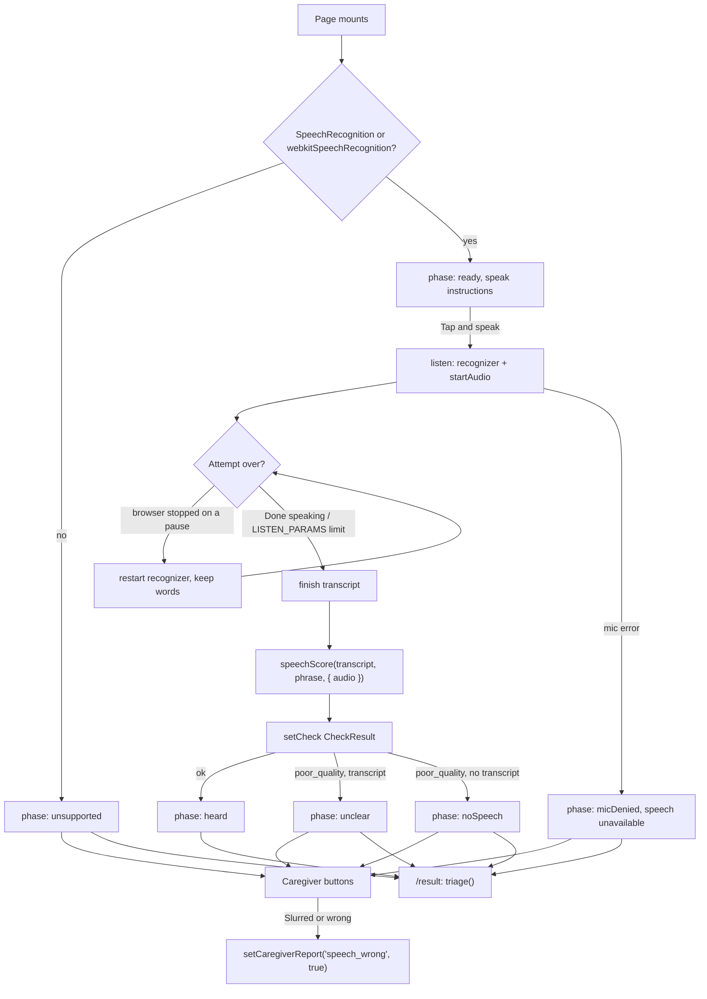

# Design: Speech Check

## Overview



`speech.ts` is pure (no DOM, no Web Speech, no Web Audio). The route collects the transcript and amplitude envelope during one attempt and calls `speechScore()` once at the end. Every number comes from `thresholds.ts`. Word scoring and `speechTiming` follow `.kiro/specs/metrics/design.md` ("Speech").

## Data contracts

```ts
// src/lib/metrics/speech.ts
words(text: string): string[]
interface SpeechAudio { amplitudes: ArrayLike<number>; sampleMs: number }
interface SpeechOptions { speakingMs?: number; audio?: SpeechAudio }
speechScore(transcript: string | null | undefined, target: string, opts?: SpeechOptions): CheckResult
speechTiming(amplitudes: ArrayLike<number>, sampleMs: number): SpeechTiming   // { speakingMs, pauseCount }
rms(samples: ArrayLike<number>): number
voicedFloor(amplitudes: ArrayLike<number>): number
interface SpeechAcoustics {
  floor: number; wordsPerSecond: number; pauseRatio: number;
  longestPauseMs: number; envelopeCv: number; score: number;
}
speechAcoustics(amplitudes: ArrayLike<number>, sampleMs: number, targetWords: number): SpeechAcoustics | null
combineSpeechScore(wordError: number, acoustic: number): number
speechErrorScore(expected: string, heard: string): number   // see "Known gaps"

// src/lib/voice.ts
VOICE_LANG: Record<Locale, string>   // en-US, es-US, pt-BR
speak(text: string, locale: Locale): void

// src/lib/stores/session.ts
setCheck(result: CheckResult): void
unavailableCheck(id: CheckId): CheckResult
setCaregiverReport(report: CaregiverReport, observed: boolean): void
```

Route state: `type Phase = 'ready' | 'listening' | 'heard' | 'noSpeech' | 'unclear' | 'micDenied' | 'unsupported'`. Judgments: `'slurred' | 'noChange' | 'notSure'`.

## How it works

### Scoring

```
wordError = 1 − LCS(words(transcript), words(target)) / |words(target)|
acoustic  = speechAcoustics(envelope, SAMPLE_MS, |words(target)|)?.score
score     = acoustic == null ? wordError : min(1, wordError + ACOUSTIC_WEIGHT × acoustic)
```

Order of checks in `speechScore`: no transcript → `unavailable`; transcript with no words → `poor_quality`; speaking time (given, or from `speechTiming` on the envelope with the fixed `QUALITY.SILENCE_LEVEL`) below `QUALITY.MIN_SPEECH_MS` → `poor_quality`; otherwise `ok`.

### Acoustic proxies

`speechAcoustics` uses the adaptive `voicedFloor` and works over the speech span only, so leading and trailing silence do not count.

| Sub-score | Measure | 0 at | 1 at | Weight |
|---|---|---|---|---|
| rate | target words / span seconds | `MIN_WORDS_PER_SEC` | `SLOW_WORDS_PER_SEC` | `WEIGHT_RATE` |
| pause | max(ramp(pause share), ramp(longest pause)) | `MAX_PAUSE_RATIO`, `LONG_PAUSE_MS` | `HIGH_PAUSE_RATIO`, `VERY_LONG_PAUSE_MS` | `WEIGHT_PAUSE` |
| envelope | std / mean of voiced amplitudes | `MIN_ENVELOPE_CV` | `FLAT_ENVELOPE_CV` | `WEIGHT_ENVELOPE` |

Rate is measured over the span, not voiced time, because the span's ends are steadier run to run. The envelope proxy is weighted lowest because fluent and slurred reads overlapped in single-tester checks (39d60d0). These are crude proxies, not a validated slur detector.

### Listening

The browser's recognizer stops after a short silence, which would cut off slow, effortful speech. So `listen()` runs recognition with `continuous: true` and restarts it in `onend` unless the app is ending the attempt. Words from earlier browser sessions are kept in `committed`. A watch timer (every `SAMPLE_MS`) ends the attempt on `LISTEN_PARAMS` limits: 10 s with no voice, 4 s of silence after voice, 30 s total. "Done speaking" calls `rec.stop()`, which delivers pending words before `onend` calls `finish()`. A `current()` guard drops events from an older recognizer.

### Audio capture

`startAudio()` creates the `AudioContext` and calls `resume()` inside the tap, then awaits `getUserMedia({ audio: true })`. An `AnalyserNode` (`fftSize` 2048) feeds one reused `Float32Array`; every `SAMPLE_MS` the route pushes `rms(frame)` to the envelope, updates the wave bars and calls `onVoice()` when the level is above `max(SILENCE_LEVEL, RELATIVE_SILENCE × peak so far)`. If the mic cannot be opened, the envelope stays empty and the word score stands alone. `stopAudio()` clears the timer, stops tracks and closes the context.

### Voice prompts

On mount the route calls `speak(t(locale, 'check.speech.instructions'), locale)`. `listen()` calls `speechSynthesis.cancel()` first so the prompt is not recorded. The phrase itself is shown on screen, not spoken.

## Safety notes

- Escalate-only. Acoustics can only add to the score (`combineSpeechScore` never goes below the word error). `poor_quality` leads to `RETRY_CAPTURE`, not a softer answer. A caregiver "Slurred or wrong" sets `speech_wrong`, which the engine turns into `CALL_911_NOW` (triage-engine Req 2.3). "No change I can hear" only removes that report; it never lowers a measured score. No copy on this screen says the speech is fine.
- Disclosure. `check.speech.disclosure` ("Speech recognition in Chrome sends audio to Google's servers.") is shown whenever recognition is available, in en, es and pt (safety.md section 4).
- Fallback buttons. Shown when recognition is unsupported, the mic is denied, nothing was heard, or the recording was unclear. They are the alternative to sending audio to Google.
- No audio stored or uploaded by the app. The envelope lives in a component variable and is analyzed in the browser. Nothing is written to IndexedDB or sent anywhere by app code. The browser's recognizer is the only part that sends audio, and that is disclosed.
- The Call 911 button comes from `+layout.svelte` and is not hidden by any phase of this screen.
- Dev readout. Raw samples and scores are shown only when `import.meta.env.DEV` is true.

## Known gaps

- `speechErrorScore()` (accent-sensitive bag-of-words) is exported and tested, and its comment says the route uses it. The route does not; it uses `speechScore()`.
- The comments on `POPULATION_THRESHOLD.speech` and `BASELINE_DEVIATION_THRESHOLD.speech` describe word error only. The speech score now also includes the acoustic term.
- `ACOUSTIC_PARAMS` were tuned on one tester's recordings. They are uncalibrated.

## Testing strategy

- `tests/speechAcoustics.property.test.ts`: `combineSpeechScore` bounds and monotonicity; `speechAcoustics` bounds, added hesitation, flattened loudness, hum below the floor, slowed attempt; `speechScore` with audio never below word-only, slowed attempt, too little speech, no transcript.
- `tests/speechMetric.test.ts`: `speechErrorScore` examples; fluent vs. slow, flat, over-paused envelopes; hum in the gaps; acoustics stacking on missed words.
- `tests/metricChecks.property.test.ts`: word scoring and `speechTiming` properties, plus a `triage()` integration test.
- `tests/pipeline.fixture.test.ts`: speech fixtures through `triage()` (`CALL_911_NOW`, `RETRY_CAPTURE`).
- The route has no automated tests. Commit 39d60d0 reports tuning listening and scoring against one tester's real recordings in Chrome.
